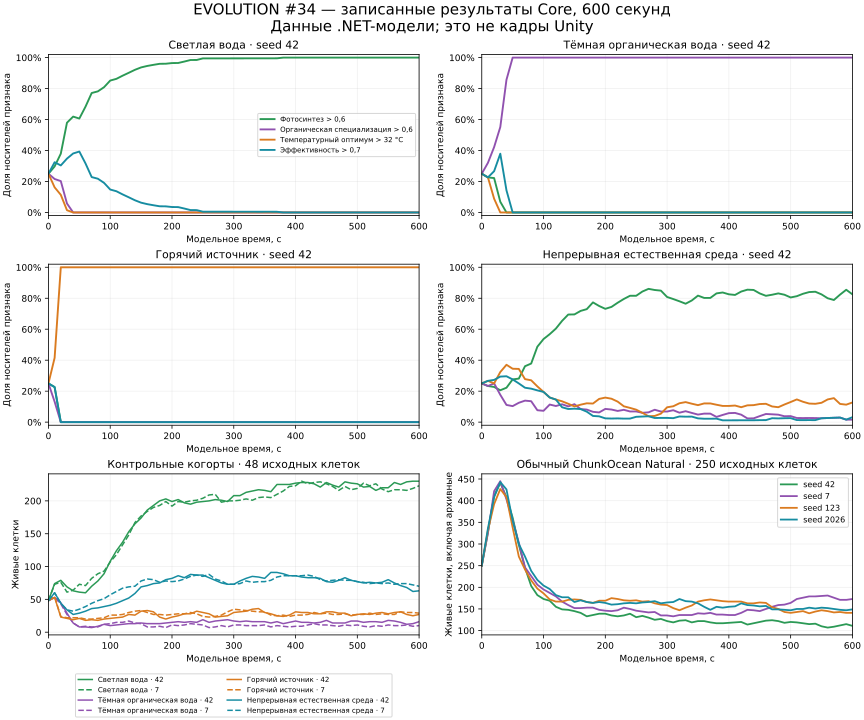

# Issue #34 — экологические ниши и естественный отбор

## Статус и база

Draft PR #35, ветка `codex/ecological-niches-34`, base `codex/living-unicellular-32`
(PR #33), точный исходный SHA `807c6ab1d9aa59ff2980dc956b9eb4f7950a74d3`.
Он включает многоклеточность #30 / PR #31 и жизненные анимации #32 / PR #33.
PR #28/#29/#31/#33 и main не изменены. Merge/auto-merge и автопилот не включались.
15 ноября пользователь разрешил облачные Unity-проверки и реальный захват; на его ПК ничего не запускалось.
Секреты и workflow-файлы не менялись; подключены дополнительные режимы существующего CI-захвата.

В **WaterPrototype3D включён Natural-режим**: `WaterPrototype` создаёт
`ChunkOcean(..., EcologicalScenario.Natural)`. Старые прямые конструкторы
`VolumeWorld`/`ChunkOcean` сохраняют Legacy по умолчанию для старой модели,
архивов и регрессионного стенда. Это не отключает новую экологию в игре.
Контрольные однородные профили доступны диагностике, а не переключаются при
пересечении клеткой невидимых границ. В игре используется непрерывная среда.

Модельные проверки выполнены: GitHub Core на E (`a165fcc`) — **301 passed, 0 failed, 0 skipped**, запуск `43696570362`. Чистая компиляция Runtime и Editor в Unity 6000.6.9f1
прошла для коммита D (`448949b`), запуск `43695937746`. Его EditMode — **310 passed / 5 timeout**,
PlayMode — **20 passed / 1 failed**. Подробности и XML-сводка ниже.
**Внешний вид, разрешения HUD, сборка и реальные кадры пока не подтверждены**. Приложенная
`4806.png` использована как художественное направление, не как скриншот.
Разрешение на облачные проверки получено. Визуальная часть Definition of Done
остаётся открытой до завершения Unity-проверок и просмотра реальных кадров.

## Проверяемые серии

| Серия | Коммит | Проверенный результат | Открытая граница |
|---|---|---|---|
| A | `afa014e012f444b6352108d0e744e544210d8d60` | Поля, запасы, консервативное перемешивание, v6; 26 нишевых/колониальных случаев | Физиология и вещество потомков интегрированы следующей серией |
| B | `f8b1ec831f7988b7123a4a5adb737dea4161645f` | Оплаченная биомасса, питание, кислород, температурная цена; 46 целевых случаев | Баланс длинных прогонов доработан в C/D |
| C | `33edd53cc3a3f8fcfed240e66137635542bbdd22` | Карта, история, реальные источники/коллизии; 30 целевых случаев | Unity/UI не выполнялись |
| D | `448949b27148076267d08eb17bb35e371eb2a830` | Повторы, 600-секундные сценарии, старые эпохи, общий моторный режим колонии, бюджет и маршрут захвата | Core 301 PASS; чистая Unity-компиляция PASS, EditMode/PlayMode/кадры ожидаются |
| E | `a165fcce6390872f3b22e735644fb18bba9fafb2` | Core 301 PASS; 5 новых + 21 прежний тест валидатора кадров PASS; захват обоих этапов подключён к CI | Unity ожидает очередь; реальные изображения ещё не получены |

Хронология локальных барьеров дополнительно сохранена в
[ECOLOGY_34_CHECKPOINTS.md](ECOLOGY_34_CHECKPOINTS.md).

## Как устроена среда

`NicheEnvironment` задаёт свет с глубиной и плавным пространственным затенением,
термоклин, локальные горячие гауссовы очаги, органическую подпитку, доступность
кислорода и предписанный поток с подъёмом у источника. Горячие центры повторяются
через 80 условных единиц по горизонтали; их позиция зависит от seed-offset.
Никакой из этих расчётов не записывает геном.

`FoodCloud` в новой модели — конечный водный резервуар: химический носитель
`Substrate`, взвешенная органика `Organic`, растворённая органика `Dissolved`,
минералы `Nutrients`, детритное вещество `DetritalMatter`, кислород `Oxygen`.
C1-ядро доступности плавно обращается в ноль на границе радиуса. Перекрывающиеся
резервуары **делят** бюджет клетки; они не умножают её фотосистемы или захват пищи.
Резервуары переносятся течением и ограниченно обмениваются запасами. Это модель
смешивания конечных резервуаров, не CFD или атомистический реакционно-диффузионный
решатель. Изолированные архивные регионы не обмениваются с соседями до загрузки.

Термальный источник имеет реальную неподвижную конечную ресурсную запись
`/vent-food`, а его каменистое тело совпадает с препятствием Core. Повторная
загрузка не создаёт второй источник. Декоративная струя отражает действующее
горячее место и запас химического носителя, но не создаёт еду. Источники добавляются
также при обновлении старой сохранённой области; их стартовые запасы явно
учитываются как начальный ввод, а не скрытая энергия.

Внешние притоки ограничены на резервуар, не масштабируются по числу клеток:
до `0.65 × химическое поле` единиц носителя/с, до `0.11 × минеральное поле`
единиц вещества/с, до `1.1 × органическое поле` энергии/с. Подпитка ограничена
ёмкостями 35 / 48 / 90 соответственно; внутреннее растворение детрита сохраняет
свою энергию отдельно от ограничения внешней подпитки. Кислород обменивается
с окружающей водой с коэффициентом 0.025/с и имеет отдельный газовый ledger.

## Отбор и цена признаков

- Фотосистемы дают энергию при свете и доступности минералов/минерального резерва.
  Их поддержка и структура стоят энергии. Полный минеральный резерв взрослой
  клетки не выключает поддерживающую фотохимию. Новая биомасса всё равно оплачивается.
- Растворённая органика и фильтрация частиц — разные конечные запасы и пути;
  химический носитель — отдельный третий путь. Органическая специализация,
  Uptake, распределение фотосистем и реальная роль клетки меняют усвоение и цену.
- Химический путь является **хемотрофным получением энергии** из уже имеющегося
  носителя. Отдельных генов хемосинтеза и полной фиксации углерода из CO₂ не добавлено.
  Тепло само по себе энергию клетке не выдаёт.
- Температурная эффективность — гладкая гауссова кривая вокруг наследуемого
  оптимума с шириной, зависящей от ThermalTolerance. Устойчивость платная даже
  при комфортной температуре. Сохраняются прежние цены Speed/Uptake/фотосистем/
  Efficiency/защиты и реальные преимущества/издержки ролей.
- Дыхание и распад расходуют кислород; фотохимия его производит. Низкий кислород
  снижает выход органического/химического питания и повышает расход. Упрощённый
  остаточный бескислородный выход не является полной моделью альтернативных акцепторов.
- NPC ощущают пищу в пределах наследуемой чувствительности и сбавляют ход рядом
  с ней. Движение остаётся платным. Вся NPC-колония использует один фактический
  моторный режим: каждый её мотор оплачивает именно усилие целого организма.

Гены взрослых клеток не переписываются при перемещении. Существующий `Genome.Inherit`
и оплаченный выбор игрока создают наследуемые отличия только у настоящего потомка.
Новые «правильные» виды не спавнятся. В обычной игре основатели по-прежнему
получают непрерывные случайные признаки; четыре диагностических начальных вектора
не используются генератором игровых регионов.

## Вещество, энергия и обратная связь

Введён отдельный **азотоподобный лимитирующий материальный трассер**, не полный
атомный баланс углерода/воды/всех элементов. Его нельзя выдавать за такую модель.
У клетки есть фактическое вещество тела и минеральный резерв. Потомок получает
`0.4 × Size` вещества тела и `0.2 × Size` резерва, полностью оплаченные родителем;
рост дополнительно переводит `0.6 × Size × прирост Growth` из резерва в тело.
Отказ не списывает энергию или вещество. При хищничестве вещество добычи
ограниченно переносится хищнику, остаток становится детритом один раз.

После смерти Core возвращает вещество в детрит; VFX #32 ничего не добавляет.
Распад детрита возвращает 85% освобождённого вещества в минералы, остаток —
учтённая потеря/осаждение. Растворение органики передаёт 70% её химической энергии
в DOC, 30% теряется; дальнейший распад DOC рассеивает энергию. Положительной
бесконечной петли переработки нет.

Растущая популяция истощает минералы/пищу, расходует кислород и реально затеняет
местные фотосистемы. Показанный свет и питание используют согласованное затенение.
Воздействие организмов на само поле течений/теплоёмкость воды не моделируется;
оно не заявляется как реализованное.

Проверяемые равенства для известного набора регионов:

- `E = InitialEnergy + Solar + ExternalChemical + ExternalOrganic − Dissipated`.
- `M = InitialMatter + ExternalMatter − MatterLost`.
- `O₂ = InitialOxygen + OxygenIn + OxygenProduced − OxygenOut − OxygenUsed`.

В M входят минералы, детритное вещество, тела и резервы. Открытие новой области
явно кредитуется в Initial-счётчики. Процедурное исследование не является рождением
или бесплатным притоком, скрытым внутри существующего баланса.

Физиология использует float32, накопленные ledgers — double. Допуски тестов:
энергия 0.005% оборота, вещество/кислород 0.02% соответствующего начального запаса
с накопленным вводом. Это допуск округления, не заявленное побитовое сохранение
вещественных единиц. Максимальные абсолютные невязки в восьми опытах:
E 0.063942, M 0.094134, O₂ 0.220029; в четырёх обычных мирах:
E 0.076514, M 0.267655, O₂ 0.749930.

## Фактические 600-секундные опыты



График строится из двух CSV командой `python3 Tools/NicheDiagnostics/plot_results.py`
(требуется matplotlib). Верхние панели показывают доли носителей отдельных признаков,
а не взаимоисключающие виды; изменения всей исходной смеси не выделяют эффект одного гена.
Нижние панели отделяют контролируемые когорты от обычного ChunkOcean.

Старт каждого опыта: 48 взрослых основателей, по 12 на каждый из четырёх начальных
генотипных векторов, энергия 65% Capacity, Size 0.8; одинаковые ДНК, позиции,
исходные органика/химический носитель и seed между условиями. Различается экологическое воздействие. Есть мелководные,
глубокие и термальные позиции; четыре термальных резервуара фиксированы как источники.
После конструкции стенда гены, позиции, энергия и пища не редактируются.

| Профиль | Свет | Температура | Особенность |
|---|---:|---:|---|
| Sunlit | 1 | 23 °C | Сильный свет, слабая органическая/химическая подпитка |
| Dark | 0 | 14 °C | Органическая подпитка, фотосинтез не кормит |
| Hydrothermal | 0.01 | 43 °C | Сильный ограниченный химический поток |
| Natural | Непрерывное поле | Термоклин + источники | Все градиенты одной пространственной среды |

Начальные маркеры: 25% Photosynthesis >0.6, 25% OrganicSpecialization >0.6,
25% PreferredTemperature >32, 25% EnergyEfficiency >0.7. Маркеры не обязаны быть
взаимоисключающими после мутаций. Hot означает горячий **оптимум**, не доказательство
универсального преимущества каждого отдельно взятого гена устойчивости.

| Среда | Seed | Живые: 48 → | Рождения | Смерти | G живых | Фото / органика / горячий оптимум | Колонии |
|---|---:|---:|---:|---:|---:|---|---:|
| Sunlit | 42 | 230 | 521 | 339 | 11 | 100% / 0% / 0% | 0 |
| Sunlit | 7 | 223 | 499 | 324 | 12 | 100% / 0% / 0% | 3 |
| Dark | 42 | 16 | 99 | 131 | 4 | 0% / 100% / 0% | 0 |
| Dark | 7 | 10 | 71 | 109 | 3 | 0% / 100% / 0% | 1 |
| Hydrothermal | 42 | 27 | 212 | 233 | 5 | 0% / 0% / 100% | 4 |
| Hydrothermal | 7 | 29 | 145 | 164 | 3 | 0% / 0% / 100% | 6 |
| Natural | 42 | 63 | 216 | 201 | 8 | 82.5% / 1.6% / 12.7% | 0 |
| Natural | 7 | 70 | 222 | 200 | 10 | 81.4% / 1.4% / 14.3% | 2 |

Полный независимый повтор всех **8 × 600 с** дал побайтно одинаковые CSV,
488 строк с шагом 10 секунд. В каждом случае выполняется `живые = 48 + рождения − смерти`.
[Все данные](diagnostics/issue-34-environments.csv). Отдельный тест закрытой тёмной
воды без внешней энергии/ресурсного притока заканчивается вымиранием к 600 с.

Это воспроизводимый причинный опыт для целых генотипов, а не доказательство
универсального исхода эволюции или независимого эффекта каждого гена. Однородные
контрольные условия намеренно сильные. В Natural сохранились разные стратегии;
число колоний не растёт автоматически и они не обязаны выигрывать.

Проверен также **обычный генератор ChunkOcean**, без диагностических генотипов:
Natural, фиксированная область наблюдения, по 600 секунд на четырёх seed.

| Seed | Живые: 250 → | Рождения | Смерти | G живых |
|---:|---:|---:|---:|---:|
| 42 | 111 | 489 | 628 | 5 |
| 7 | 173 | 573 | 650 | 7 |
| 123 | 141 | 568 | 677 | 9 |
| 2026 | 149 | 601 | 702 | 5 |

[Игровой мир, активные + архивные, баланс каждые 10 с](diagnostics/issue-34-game-world.csv).
Все конечные живые в этих четырёх срезах находятся в активной области. Эти числа
не гарантируют вечной устойчивости и не сравниваются как идентичный баланс с
Legacy: ресурсные поля и давление отбора здесь намеренно другие.

## Интерфейс и внешность

Обычная мини-карта переключает население, свет, температуру, минералы, кислород,
химическую пищу, органику и наследуемые стратегии. Экологические плитки относятся
к явно указанному срезу Y. Аналитический объёмный обзор имеет также слой среднего
наследуемого температурного оптимума. Для пустой области этот признак не рисуется.
Старые слои линий/форм/плотности/течений сохранены.

Карточка клетки объясняет действительный источник энергии и дефицит: минералы,
кислород, свет, температурную эффективность, укус или расходы. Обмен колонии
различается с собственным питанием. Научная детализация раскрывает конкретные
запасы. История каждые 10 с хранит доли маркеров и средние поколения, ограничена
128 записями и сохраняется. Изменение окна наблюдения разрывает сравнение тренда;
миграция не объявляется доказанной генетической адаптацией. История относится к
наблюдаемой области, не к «всей бесконечной планете».

Пластиды/моторы/мембрана #32 отражают реальные гены и состояние; наследуемый горячий
оптимум с устойчивостью слегка меняет оттенок оболочки. Шейдер/рендер не влияют
на численный результат. Художественное качество, читаемость легенд, взаимодействие
и размер текста на 1366×768 / 1920×1080 / 2560×1440 требуют настоящего Unity QA.

## Сохранения и совместимость

Читаются региональные форматы v1–v5, пишется **v6** с конечными запасами и веществом.
Старые сборки не читают v6. Ledger имеет свою версию 6, обзор читает EVS1 и пишет
EVS2; экологическая история — отдельный ограниченный sidecar. Формат v6 выбран
потому, что восстановление кислорода/минералов из генов при каждом входе давало бы
бесплатное пополнение. Флаг инициализации сохраняется.

При первом переходе со старого правила создаётся явная энергетическая эпоха:
состояние клеток сохраняется, прошлые энергетические расходы не смешиваются с новым
начальным запасом. Отложенное **старое** время региона до границы эпохи сначала
досчитывается по Legacy, затем включаются ниши. Наследование, возраст и энергия
при самой инициализации не меняются. Это отдельно протестировано. После перехода
смерть/рождение из архива не переигрываются как новые визуальные события.

Связи, роли, управление целым/одной клеткой и Y из #30/#32 сохранены. Каждый член
сам платит за ткани и движение; N-перенос между членами колонии отдельно не
моделируется, прежний Transport переносит энергию. Чанковый архив остаётся
изолированным до загрузки. Атомарность файлов сохранений — по одному файлу,
без новой межфайловой транзакции.

## Проверки и измеренный бюджет

- Локальный полный проход до последней полировки общего моторного режима:
  **296 passed, 0 failed, 0 skipped**, 5m47s.
- После полировки: **23/23 NicheTests**, включая предацию вещества, три частоты
  наблюдения 15/60/144, переход эпохи, общий моторный режим и отсутствие бесплатных
  делений; **8/8 NicheSelectionTests**, 48 секунд, включая 4 × 600 с и голод.
- Полный финальный GitHub Core/NUnit и точный head — в описании PR. Unity-задачи
  остаются opt-in и не считались выполненными.
- C# 9: 101 файл Assets, синтаксис PASS; раздельные Core/Presentation/Volume/
  Localization/tests без Unity-заглушек PASS. Это не Unity API compilation.
- .meta/GUID: 144 уникальных; source metadata, asmdef JSON, аудиомодуль,
  локализация и `git diff --check` PASS.

[Сводка из настоящих TRX и названия тестов](diagnostics/issue-34-tests.json).
Сохранены прежние 269 случаев и добавлены проверки старого v5 в новом reader,
пространственной непрерывности, платных потоков, материала, газов, состояния
паузы/наблюдения, наследования, stream/save, настоящих источников и пищевой цепи.

Цель модельного шага — укладываться в 50 мс при штатных 20 Hz для сотен жителей.
Измерено .NET Release, seed 42, 100 прогревочных + 300 измеряемых шагов, без Unity:
421 слот в конце измерения, живых 268 → 411; медиана **7.95040 мс**, p95 **13.83460 мс**,
**3184.05 байт/шаг**. Аллокации не объявляются нулевыми: есть настоящие рождения и
обновление структур. [CPU CSV](diagnostics/issue-34-cpu.csv).
Это модельный шаг, не FPS, не GPU, не Unity draw/UI, не streaming/catch-up latency.

Сохранены бюджет детализации #32 (13 жителей), instancing, ограниченные очереди
событий, фиксированные временные эффекты; по источнику добавлено 16 декоративных
слотов. Поиск пищи ограничен сенсорным радиусом; для физики/конкуренции остаются
некоторые квадратичные проходы. Верхний предел 2048 и длинные архивные интервалы
требуют отдельного профилирования в Unity.

## Воспроизведение

```sh
dotnet test Tools/CoreTests/CoreTests.csproj -c Release --nologo
python3 Tools/check_model_assemblies.py
python3 Tools/check_localization.py
dotnet run --project Tools/NicheDiagnostics/NicheDiagnostics.csproj -c Release > first.csv
dotnet run --project Tools/NicheDiagnostics/NicheDiagnostics.csproj -c Release > repeat.csv
python3 Tools/ci/check_niche_results.py first.csv repeat.csv
dotnet run --project Tools/NicheDiagnostics/NicheDiagnostics.csproj -c Release -- --world
dotnet run --project Tools/NicheDiagnostics/NicheDiagnostics.csproj -c Release -- --profile
```

Для **отдельно разрешённого** настоящего захвата подготовлен дополнительный флаг:

```sh
EVOLUTION_PREVIEW_SHA=<exact-head> ./Evolution.x86_64 \
  -evolution-visual-preview <output-directory> -evolution-ecology
python3 Tools/ci/check_niche_capture.py <output-directory>
```

Это тот же игровой рендер, in-memory архив, реальные жители и обычные Core-шаги.
Ожидаются 8 оригинальных PNG слоёв/состояния после 600 с и `ecology.json` с версией,
revision/date, историей и остатками ledger. Никаких фиктивных генов, телепортаций,
подкормок или фото из концепта. Маршрут подготовлен, **не запускался**; автоматический
валидатор не заменяет просмотр изображения. Workflow-файлы не менялись; после разрешения пользователя добавлена opt-in метка `unity-editor-ci`.

Независимому ревью: проверить границу эпохи старых архивов, conservation при
предации/делении/перекрытии резервуаров, адекватность импортов и температурных цен,
выводы из многопризнаковых опытов; затем отдельно скомпилировать Unity и подтвердить
карту, управление, сохранения и реальную визуальную связь «среда → цена → успех».
## Разрешённая проверка Unity и реальные кадры

15 ноября 2026 пользователь разрешил облачные Unity-проверки и захват кадров без запуска на его ПК.
В существующем Unity Editor CI включён `unity-editor-ci`; сборка остаётся Draft, слияние не выполняется.
Один настоящий Linux IL2CPP player проходит прежний smoke-захват, затем два дополнительных режима:
`EVOLUTION_CAPTURE_MODE=ecology` и `EVOLUTION_CAPTURE_MODE=living` в `Tools/ci/visual_preview.sh`.
Режим ecology сохраняет 8 кадров карты, 12000 настоящих шагов модели (600 с) и историю поколений.
Режим living сохраняет 120 кадров движения, 50 кадров оплаченного деления и 81 кадр реальной гибели.
Новые JSON включают измерения каждого framebuffer, графический API, URP, версию Unity и точный SHA.
Валидатор отклоняет другой SHA, fixture, Null graphics, пустые/повторяющиеся кадры и неподтверждённый жизненный цикл.
Пять локальных тестов валидатора и 21 прежний тест проверки кадров прошли; это тесты валидатора, не визуальные доказательства.
На момент этого коммита EditMode продолжает выполняться, новые кадры ещё не получены.
Последующие фактические результаты и ссылки на артефакты публикуются в описании Draft PR #35;
статус выше фиксирует подтверждённые проверки на момент коммита, а не будущий исход CI.

## Первый фактический Unity-барьер (D)

[Unity CI 43695937746](https://github.com/evgenijzingaev-dev/Evolution/actions/runs/43695937746):
чистая компиляция PASS; EditMode 315 случаев — 310 passed, 5 failed по стандартному лимиту 180000 мс;
PlayMode 21 случай — 20 passed, 1 failed. Сборка и захват не запускались из-за барьера тестов.
[Сводка настоящих XML](diagnostics/issue-34-unity-checks.json), исходный артефакт `unity-test-results` ID 14156590111.

Четыре прежних 600-секундных опыта заняли в Unity Editor/Mono 292–385 с,
полное двухмировое воспроизведение — 759 с. В серии G этим двум методам задан явный
20-минутный Timeout; все 12000 шагов, seed и утверждения баланса/детерминизма сохранены.
Это изменение лимита теста, а не подтверждение производительности Unity и не пропуск проверки.

PlayMode сравнивал `VolumeAgent` по старому индексу после перевода камеры к другой клетке.
Индексы меняются при потоковой загрузке, а исходная область может выгрузиться. Тест теперь
возвращает камеру к исходной клетке, находит её по устойчивому Identity и сравнивает **всю**
структуру и исходный Tick. Игровая биология и production-код этой правкой не меняются.
Исправления ожидают фактического повторного Unity-прохождения; PASS заранее не заявляется.
